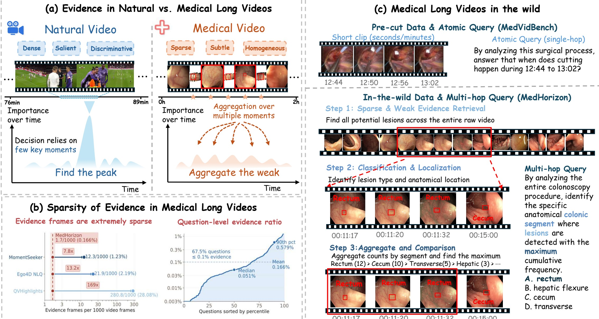

<div align="center">

# MedHorizon
### Towards Long-context Medical Video Understanding in the Wild

[Paper](https://arxiv.org/abs/2605.06537) · [Dataset](https://huggingface.co/datasets/DBD123/MedHorizon) · [Evaluation](docs/evaluation.md) · [Results](results/README.md) · [中文说明](README_zh.md)

**340 full-procedure videos · 1,253 questions · 8 sources · 13 tasks**

</div>

MedHorizon evaluates whether multimodal models can find sparse evidence and reason across complete medical procedures. It covers surgery, endoscopy, colonoscopy, and ultrasound, with tasks spanning fine-grained visual understanding and multi-hop clinical reasoning.



The paper reports **759 decoded video hours** and a mean question-level evidence ratio of **0.166%**. The released annotation duration fields use a different, currently unreconciled total; see the [data notes](docs/data.md#duration-metadata). This repository preserves the published annotations exactly.

## Release contents

| Path | Contents |
| --- | --- |
| `data/medhorizon_test.jsonl` | Official test annotations, identical to the Hugging Face release |
| `data/evidence_windows.jsonl` | Evidence metadata aligned to all 1,253 question IDs, including support/proxy flags |
| `data/manifest.json` | Checksums, task counts, and release provenance |
| `medhorizon/` | Data validation, inference preparation, scoring, and an optional ms-swift runner |
| `results/` | The manuscript's reported results for 25 models/methods |
| `docs/` | Data access, evaluation protocol, construction notes, and project page source |
| `tests/` | Checks for data integrity, task mapping, input preparation, and scoring |

The benchmark provides a **test split**. Use it for evaluation, with the gold labels and evidence held out of ordinary model inputs.

## Quick start

Python 3.10 or newer is sufficient for validation, preparation, and scoring. Run these commands from the repository root:

```bash
git clone https://github.com/xmed-lab/MedHorizon.git
cd MedHorizon
python -m medhorizon validate \
  --manifest data/manifest.json \
  --evidence data/evidence_windows.jsonl
```

Obtain videos from the [dataset release and original sources](docs/data.md#video-access). Place them under a common directory, keeping paths such as `tmvp/087.mp4` and `us_study/01-lus.mp4`.

```bash
python -m medhorizon prepare \
  --video-root /path/to/videos \
  --output outputs/medhorizon_swift.jsonl
```

The generated input contains system/user messages, video paths, and stable question IDs. Gold answers, evidence windows, and historical question variants are omitted. For a text-only control, replace `--video-root ...` with `--text-only`; for your own inference backend, add `--format flat`.

### Run a model

The optional runner uses the ms-swift environment recorded in the source workspace. Install a PyTorch build for your hardware, then:

```bash
python -m pip install -r requirements-inference.txt
CUDA_VISIBLE_DEVICES=0 python -m medhorizon.infer_swift \
  --input outputs/medhorizon_swift.jsonl \
  --model Qwen/Qwen3-VL-8B-Instruct \
  --max-frames 64 \
  --output outputs/qwen3vl8b_predictions.jsonl
```

This example uses a Qwen VL 1 FPS input with a maximum of 64 frames. Frame controls differ across model families; see [evaluation settings](docs/evaluation.md). Use `--limit 2` with a separate output path for a smoke run, or `--resume` to continue an interrupted run with the same input and configuration. The runner has input and interface checks; full GPU inference has not been rerun as part of this repository cleanup.

### Score predictions

Write one JSON object per question, using the original `uid`:

```json
{"uid": "0", "prediction": "A"}
```

```bash
python -m medhorizon score \
  --predictions outputs/qwen3vl8b_predictions.jsonl \
  --output outputs/metrics.json \
  --details outputs/per_question.jsonl
```

The scorer reports overall accuracy and breakdowns by task, source, and capability. It matches predictions by ID, rejects duplicate/unknown IDs, and requires complete coverage by default. The default answer format accepts a single A/B/C/D letter; the explicitly selected `--answer-format legacy` reproduces the original workspace parser. [Full scoring contract →](docs/evaluation.md#prediction-format-and-scoring)

## Reported benchmark results

Selected rows from the manuscript table; accuracy is in percent. Input budgets vary by model and are part of the comparison.

| Model | Input | Overall accuracy |
| --- | --- | ---: |
| Gemini-3.1-Pro-Preview | 1 FPS, capped | 41.1 |
| GPT-5.4 | 1 FPS, capped | 32.6 |
| GPT-5.4-mini | 1 FPS, capped | 31.2 |
| LLaVA-Video-72B | 1 FPS, capped | 29.4 |
| WFS-SB | 128 frames | 28.1 |
| InternVL3.5-8B | 64 frames | 27.0 |
| Qwen3-VL-8B | 1 FPS, capped | 26.2 |

The [full table](results/paper_results.csv) contains all 25 rows and 13 task columns. These are archived reported values, not new runs from the inference example above.

## Documentation

- [Data format, source access, task taxonomy, and evidence limitations](docs/data.md)
- [Evaluation protocol and prediction formats](docs/evaluation.md)
- [Benchmark construction and release provenance](docs/construction.md)
- [Project page source and local preview](docs/site/README.md)

## Citation

```bibtex
@article{du2026medhorizon,
  title={MedHorizon: Towards Long-context Medical Video Understanding in the Wild},
  author={Du, Bodong and Liu, Bowen and Yu, Yang and Ding, Xinpeng and Wu, Zhiheng
          and Wang, Shuning and Nie, Shuo and Liu, Naiming and Chen, Qifeng
          and Song, Yangqiu and Li, Xiaomeng},
  journal={arXiv preprint arXiv:2605.06537},
  year={2026},
  url={https://arxiv.org/abs/2605.06537}
}
```

## Data terms and acknowledgments

The MedHorizon dataset card specifies **CC BY-NC 4.0** for the derived benchmark metadata. Raw videos remain subject to their original dataset terms. See [data licensing and attribution](data/README.md). We thank the creators of AutoLaparo, Galar, GraSP, MultiBypass140, PitVQA, REAL-Colon, TMVP, and US-Study.
